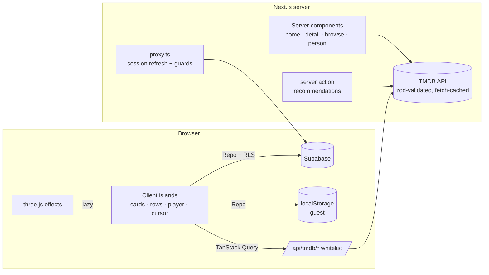

# Reelhouse

A cinematic movie-discovery site: trending, top-rated and world cinema (Hindi, Tamil, Telugu, Malayalam, Kannada, Korean, Japanese and more) with trailers, cast, reviews, profiles and a watchlist. The motion is "Lusion-level": a film-reel cursor, smooth scroll, scroll-driven scenes, shared-poster page transitions and WebGL film effects.

> The spec this was built from lives in the repo root (`README.md` + `00-overview/` … `05-phase-polish/`).

## Quick start

```bash
corepack enable            # pnpm 9
pnpm install
cp .env.example .env.local # add TMDB_READ_TOKEN for real data (optional)
pnpm dev                   # http://localhost:3000
```

With no `TMDB_READ_TOKEN`, the site runs on an **offline demo catalogue** with invented titles and designed image fallbacks, and shows a banner. Add the token and restart to get real posters, backdrops, logos and trailers.

With no Supabase variables, the site runs in **guest mode**: profiles, list, ratings, reviews and history live in the browser. Add Supabase to enable accounts (below).

## Environment

| Variable | Needed for |
|---|---|
| `TMDB_READ_TOKEN` | TMDB v4 "API Read Access Token" — themoviedb.org → Settings → API. Server-only; never prefix with `NEXT_PUBLIC_`. |
| `NEXT_PUBLIC_SUPABASE_URL`, `NEXT_PUBLIC_SUPABASE_ANON_KEY` | Accounts (email/password, magic link, Google). |
| `NEXT_PUBLIC_SITE_URL` | Canonical URLs, sitemap, OG. |
| `REVALIDATE_SECRET` | `POST /api/revalidate` (header `x-revalidate-secret`). |
| `TMDB_FIXTURES=1` | Force the offline catalogue (CI, demos). |

## Scripts

| Script | What it does |
|---|---|
| `pnpm dev` / `build` / `start` | Next.js |
| `pnpm lint` / `typecheck` / `format` | ESLint (flat config), `tsc --noEmit`, Prettier |
| `pnpm test` / `test:coverage` | Vitest unit + component tests (coverage ≥ 80% on `lib/` and `stores/`, enforced) |
| `pnpm test:e2e` | Playwright: guest flows, keyboard search, list persistence, reduced motion, mobile, axe a11y, visual regression |
| `pnpm sounds` | Regenerates the procedural UI sound sprite |

Visual baselines: `pnpm exec playwright test --project=visual --update-snapshots`.

## Supabase

1. Create a project; copy the URL and anon key into `.env.local`.
2. Apply the schema: `supabase link --project-ref <ref> && supabase db push` (runs `supabase/migrations/*`).
3. Run the RLS tests: `supabase test db` (`supabase/tests/rls.test.sql`: user A can't read B's rows, own-only review edits, length validation, 5-profile cap, cascade delete).
4. Auth → URL configuration: add `<site>/auth/callback` as a redirect URL; enable the Google provider if wanted.

## Architecture



- `src/lib/tmdb` — server-only client (`tmdbFetch`, retry, typed errors), endpoints, zod schemas, image loader, poster meta (dominant colour + blur), fixtures.
- `src/lib/data` — the `Repo` interface with `local` (guest) and `supabase` backends, plus the offline queue.
- `src/components/motion` — cursor, Lenis provider, reveal/split/scrub/parallax/pin/horizontal primitives, marquee, counters, preloader.
- `src/components/layout` — navbar, footer, transition layer, search palette, micro-interactions.
- `src/components/gl` + `src/shaders` — hero displacement, film burn, grain/gate weave, dust, gallery bend + ripple.
- `docs/DECISIONS.md` — every dependency and the architectural calls.

## Deploy (Vercel)

1. Import the repo. Framework preset: Next.js; install command `pnpm install`.
2. Set the env vars above per environment (TMDB token server-only). Use separate Supabase projects for preview and production.
3. Security headers (CSP, HSTS, Referrer-Policy, Permissions-Policy, X-Frame-Options) come from `next.config.ts`.
4. After deploy, save a Lighthouse run into `docs/perf/` (see `docs/perf/README.md`).

### Monitoring (optional Sentry)

`src/lib/monitoring.ts` is the single capture point, used by every error boundary. Sentry is already wired (`src/instrumentation.ts`, `src/instrumentation-client.ts`, `src/lib/sentry-options.ts`) and turns on when `NEXT_PUBLIC_SENTRY_DSN` is set. For readable stack traces, also set `SENTRY_AUTH_TOKEN`, `SENTRY_ORG` and `SENTRY_PROJECT` in Vercel so builds upload source maps (they're deleted from the output afterwards).

## Attribution

This product uses the TMDB API but is not endorsed or certified by TMDB. Watch-provider data is from JustWatch. Trailers are YouTube embeds; no films or images are rehosted. See `docs/CREDITS.md`.
